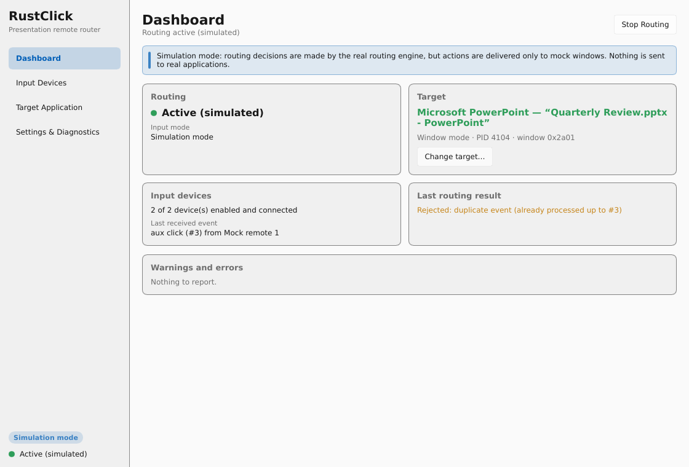
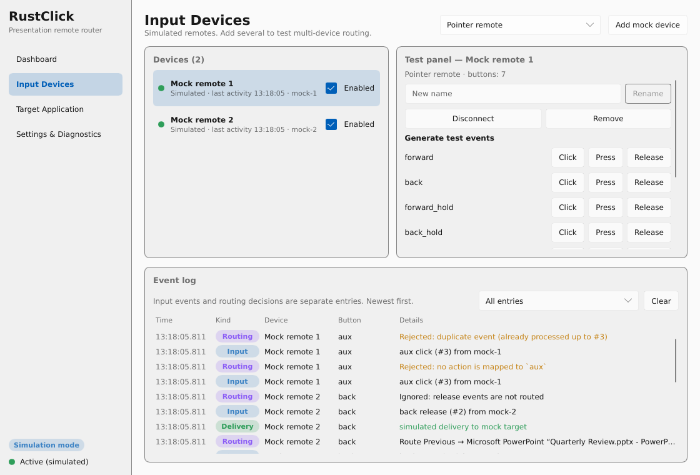
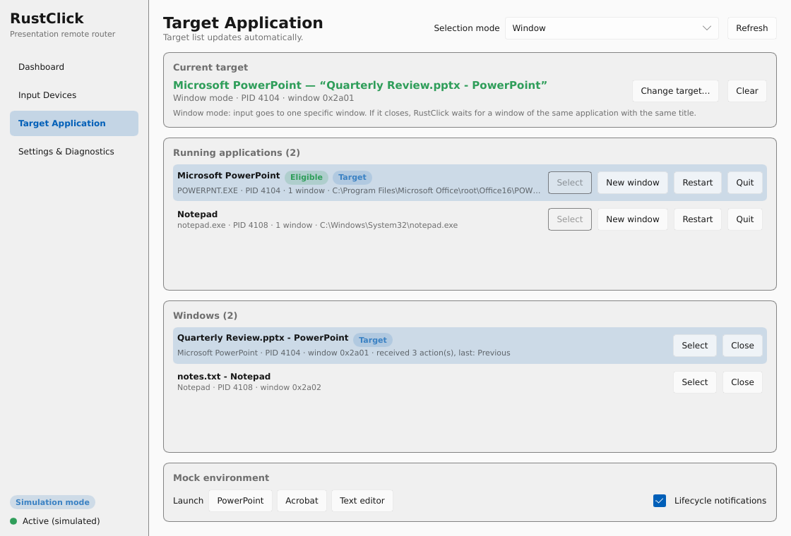
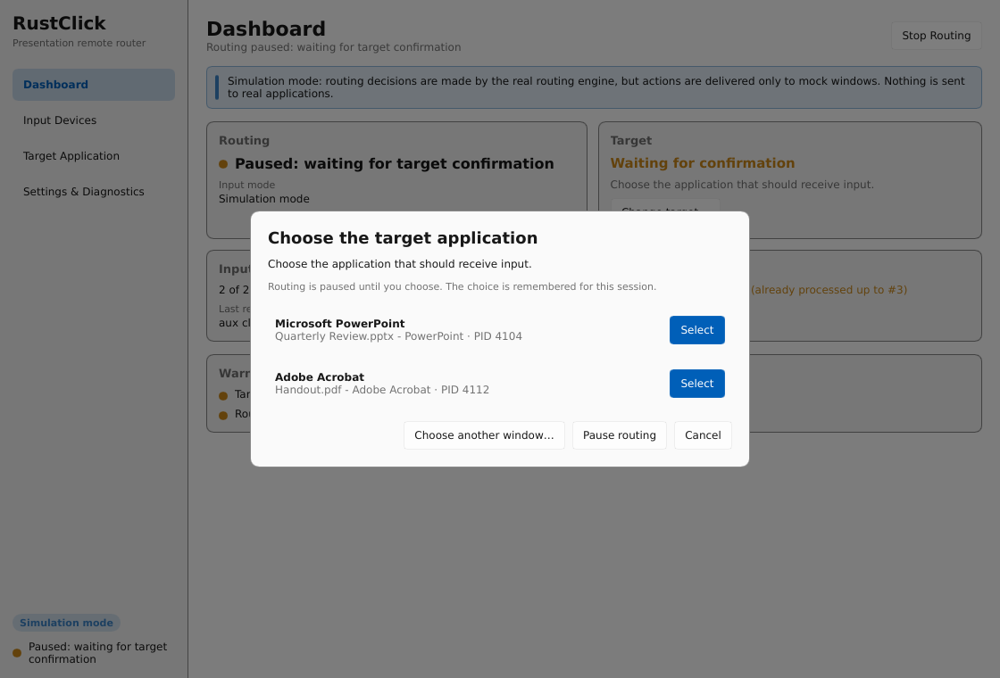

# RustClick

RustClick routes button presses from presentation remotes (such as the
Logitech R500s and Spotlight) to a chosen application, for example
Microsoft PowerPoint or Adobe Acrobat, without that application needing
keyboard focus.

It is a native desktop utility written in Rust with a [Slint](https://slint.dev) UI.
There is no web view, Electron, Tauri or Node.js runtime.



## Status

This is the **MVP milestone**: a working application with a complete
simulation environment. Native input capture and delivery to real
applications are **not implemented yet**, and the application says so
everywhere they would matter.

| Area | State |
|---|---|
| Slint UI (dashboard, devices, targets, settings, diagnostics) | Working |
| Platform-independent routing engine | Working, unit and integration tested |
| Mock input devices (several at once) | Working |
| Mock applications and windows with lifecycle simulation | Working |
| Ambiguous-target detection and confirmation dialog | Working |
| Window/process target modes, closure, restart and replacement handling | Working |
| Versioned TOML configuration | Working |
| Native input (Windows / macOS / Linux) | Not implemented, reported as such |
| Native window discovery and delivery | Not implemented, reported as such |
| Global change-target shortcut | Not implemented, reported as such |

In simulation mode the real routing engine makes every decision. The only
difference is that actions are recorded by mock windows instead of being sent
to real applications. Simulated events can never reach a native application.

## Quick start on Arch Linux

```bash
# Toolchain and the libraries Slint's default backend uses at build and run time.
sudo pacman -S --needed base-devel rustup fontconfig freetype2 libxkbcommon \
    wayland libx11 libxcursor libxrandr libxi libglvnd mesa
rustup default stable        # Rust 1.92 or newer

git clone <this repository> rustclick && cd rustclick
cargo run
```

The application starts in simulation mode with one mock remote and a mock
PowerPoint window, which is selected automatically because it is the only
eligible application. No physical remote, vendor software, root privileges or
second computer is needed.

### A two-minute tour

1. **Dashboard** → *Start Routing*.
2. **Input Devices** → in the test panel, press *Click* next to `forward`.
   The event log shows the input event, the routing decision (`Route Next → …`)
   and the simulated delivery as separate entries.
3. **Target Application** → *Launch Acrobat*, then *Change target…* The
   confirmation dialog lists both applications. Routing stays paused until you choose.
4. *Close* the selected window. Routing pauses, and events are rejected instead
   of going anywhere else. *Restart* the process, or launch it again, and
   RustClick rebinds by executable path and window title, never by PID.
5. **Settings & Diagnostics** shows each native capability's real status.

| Devices and event log | Target selection | Ambiguous target |
|---|---|---|
|  |  |  |

## Development

```bash
cargo fmt --check
cargo clippy --all-targets --all-features -- -D warnings
cargo test --all-targets
cargo run
```

The tests need no display: core and service tests are plain Rust, and the
UI binding test uses Slint's headless testing backend. To render every page to
PNG without opening a window, run
`cargo run --example screenshots -- <dir> [width] [height]`.

The configuration lives in the per-user config directory
(`~/.config/rustclick/config.toml` on Linux). Set
`RUSTCLICK_CONFIG_DIR=/some/dir` to use a different one, for example while
developing.

More documentation:

- [docs/development.md](docs/development.md): setup, builds, packaging, cross-compilation
- [docs/architecture.md](docs/architecture.md): layers, threading, routing and target lifecycle
- [docs/native-input.md](docs/native-input.md): native adapter plans and platform limitations
- [docs/manual-testing.md](docs/manual-testing.md): manual test procedures per platform

## Licensing

RustClick is licensed under **GPL-3.0-only** (see [LICENSE](LICENSE)).

Slint 1.18 is available under GPL-3.0-only, the *Slint Royalty-free Desktop,
Mobile, and Web Applications License 2.0*, or a commercial license. Using
Slint under the GPL means RustClick must stay GPL-compatible when distributed;
there are no further conditions. To distribute RustClick under a different
license, the royalty-free license is an option for desktop applications. It
requires attribution, either through the `AboutSlint` widget in an About
screen (RustClick already shows one under *Settings & Diagnostics → About*)
or through the "Made with Slint" badge on the download page. It does not
cover embedded systems. The full texts ship with the `slint` crate (`LICENSES/`);
review the current terms at <https://slint.dev> before publishing.

The direct dependencies other than Slint are MIT and/or Apache-2.0. The
transitive dependencies also include other permissive licenses (BSD, Zlib,
Unicode-3.0, BSL-1.0). Generate a full notice file (for example with
`cargo about`) before distributing binaries.
